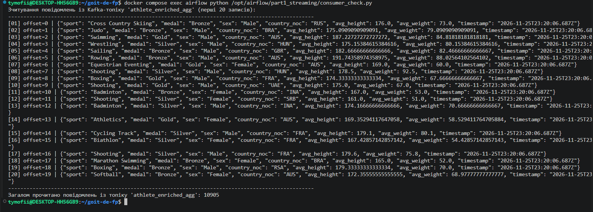
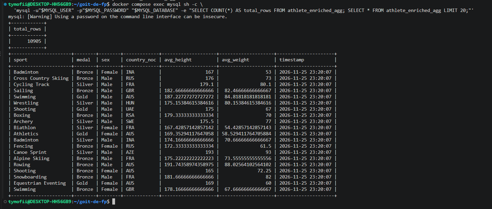
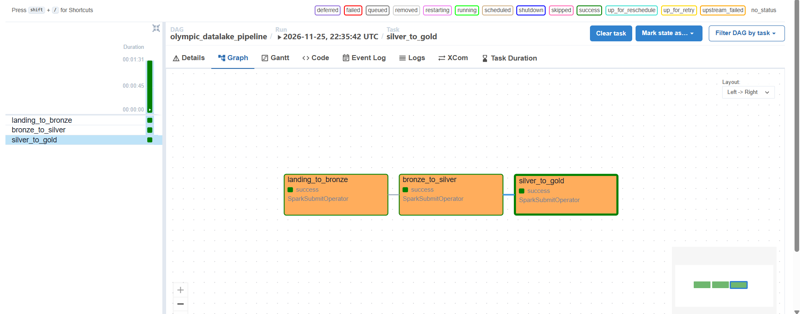
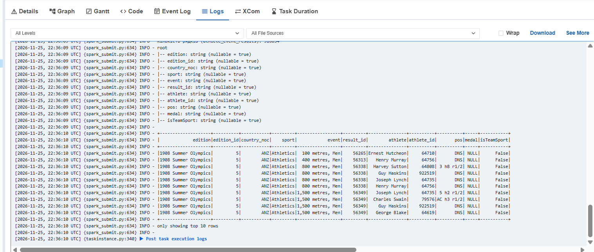
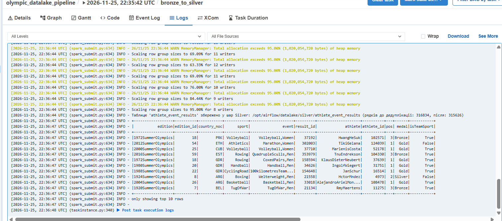
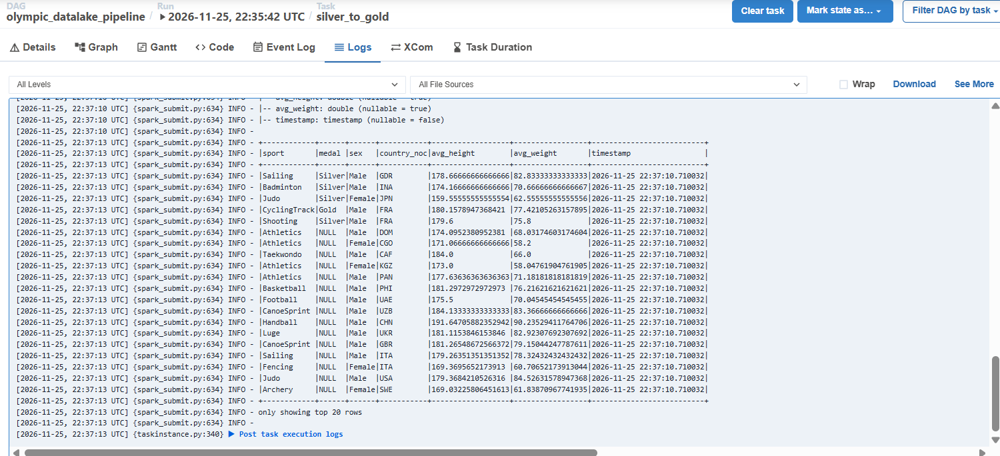

# GoIT Data Engineering — Фінальний проєкт

Фінальний проєкт демонструє побудову двох наскрізних (End-to-End) пайплайнів обробки даних на базі **Apache Spark (PySpark)** для підготовки ознак (features) ML-моделей на даних Олімпійських ігор:

1. **Частина 1 — End-to-End Streaming Pipeline:** потокова обробка результатів змагань із використанням **MySQL**, **Apache Kafka** та **Spark Structured Streaming** (`foreachBatch` Fan-Out у Kafka та MySQL).
2. **Частина 2 — End-to-End Batch Data Lake:** пакетна трирівнева архітектура **Medallion (Landing → Bronze → Silver → Gold)** у форматі **Parquet** під оркестрацією **Apache Airflow** (`SparkSubmitOperator`).

Обидва пайплайни розраховують середні зріст (`avg_height`) та вагу (`avg_weight`) атлетів у розрізі комбінації `(sport, medal, sex, country_noc)` із додаванням часової мітки обчислення (`timestamp`).

---

## Архітектура та стек технологій

Проєкт розгорнуто повністю локально в ізольованих Docker-контейнерах через єдиний `docker-compose.yml`:

| Сервіс | Образ / технологія | Порт | Призначення |
| :--- | :--- | :--- | :--- |
| **`mysql`** | MySQL 8.0 | `3306` | Локальна БД `olympic_dataset`: вхідні таблиці `athlete_bio`, `athlete_event_results` та вихідна агрегована таблиця `athlete_enriched_agg` |
| **`kafka`** | Apache Kafka 3.8.0 (KRaft) | `9092` | Локальний брокер без Zookeeper та автентифікації: вхідний топік `athlete_event_results`, вихідний топік `athlete_enriched_agg` |
| **`airflow`** | Apache Airflow 2.10.3 + Python 3.11 + OpenJDK 17 + PySpark 3.5.3 | `8080` | Оркестрація DAG Частини 2 через `SparkSubmitOperator` (`conn_id='spark_default'`, `local[*]`) та середовище запуску Spark-скриптів Частини 1 |

### Джерела даних

Використано публічні датасети курсу з сервера `https://ftp.goit.study/neoversity/`:
* `athlete_bio.csv` — біологічні та довідкові дані атлетів (155 861 рядок).
* `athlete_event_results.csv` — історичні результати виступів атлетів на змаганнях (316 834 рядки).

---

## Інструкція запуску

### 1. Підготовка змінних оточення

У корені репозиторію необхідно створити файл `.env` (додано до `.gitignore`, щоб паролі не потрапляли до публічного репозиторію):

```dotenv
# Налаштування локальної бази даних MySQL
MYSQL_ROOT_PASSWORD=root_password
MYSQL_DATABASE=olympic_dataset
MYSQL_USER=de_user
MYSQL_PASSWORD=de_password
MYSQL_HOST=mysql
MYSQL_PORT=3306
MYSQL_OUTPUT_TABLE=athlete_enriched_agg

# Налаштування локального брокера Kafka
KAFKA_BOOTSTRAP_SERVERS=kafka:9092
KAFKA_INPUT_TOPIC=athlete_event_results
KAFKA_OUTPUT_TOPIC=athlete_enriched_agg

# UID користувача хосту для коректних прав доступу до змонтованих директорій
AIRFLOW_UID=1000
```

### 2. Запуск Docker-інфраструктури

```bash
docker compose up -d --build
```

Перевірка стану контейнерів і версії Spark:

```bash
docker compose ps
docker compose exec airflow spark-submit --version
```

Веб-інтерфейс Apache Airflow доступний за адресою `http://localhost:8080` (логін: `admin`, пароль: `admin`). Підключення `spark_default` (`local[*]`) створюється автоматично під час старту контейнера.

---

## Частина 1. Building an End-to-End Streaming Pipeline

### Опис реалізації

Усі етапи завдання промарковано в коді коментарями (`# Етап 1` … `# Етап 6.b)`):

1. **Підготовка локальної БД (`init_mysql.py`):** завантажено CSV-файли у директорію `datalake/landing/` та збережено їх через JDBC у таблиці `olympic_dataset.athlete_bio` (155 861 рядок) і `olympic_dataset.athlete_event_results` (316 834 рядки).
2. **Етапи 1–2 (`streaming_pipeline.py`):** зчитано таблицю `athlete_bio` з MySQL через JDBC (`mysql-connector-j-8.0.32.jar`). Поля `height` та `weight` безпечно приведено до типу `double` за допомогою `try_cast` (захист від помилок на порожніх рядках і діапазонах на кшталт `58-62`), відфільтровано невалідні та недодатні значення, а також виконано дедуплікацію за `athlete_id` для гарантування зв'язку *1-to-many*.
3. **Етап 3 (`producer.py` + `streaming_pipeline.py`):**
   * *Частина А:* зчитано `athlete_event_results` із MySQL і відправлено 316 834 JSON-повідомлення у вхідний Kafka-топік `athlete_event_results`.
   * *Частина Б:* налаштовано `spark.readStream` із топіку `athlete_event_results`, виконано декодування байтів `value` у рядок та парсинг JSON у колонки за явною схемою `StructType`.
4. **Етап 4 (`streaming_pipeline.py`):** виконано Stream-Static `join` потоку подій із очищеним довідником `athlete_bio` за ключем `athlete_id` із використанням оптимізації `broadcast()` та усуненням колізії колонки `country_noc`.
5. **Етап 5 (`streaming_pipeline.py`):** виконано групування за `(sport, medal, sex, country_noc)`, розраховано `avg_height` і `avg_weight`, додано колонку `timestamp` через `current_timestamp()`.
6. **Етап 6 (`streaming_pipeline.py`):** реалізовано патерн **Fan-Out** усередині `foreachBatch` (`outputMode="update"`, кешування мікробатчу через `persist()`/`unpersist()`):
   * **6.а)** серіалізація у JSON (`to_json(struct("*"))`) і запис у вихідний Kafka-топік `athlete_enriched_agg`;
   * **6.b)** запис через JDBC у таблицю `olympic_dataset.athlete_enriched_agg` бази даних MySQL.

### Команди запуску Частини 1

```bash
# 1. Наповнення локального MySQL вхідними таблицями
docker compose exec airflow spark-submit \
  --jars /opt/airflow/jars/mysql-connector-j-8.0.32.jar \
  /opt/airflow/part1_streaming/init_mysql.py

# 2. Відправка подій змагань із MySQL у вхідний Kafka-топік (Етап 3.А)
docker compose exec airflow spark-submit \
  --conf spark.jars.ivy=/home/airflow/.ivy2 \
  --packages org.apache.spark:spark-sql-kafka-0-10_2.12:3.5.3 \
  --jars /opt/airflow/jars/mysql-connector-j-8.0.32.jar \
  /opt/airflow/part1_streaming/producer.py

# 3. Запуск потокової обробки та Fan-Out запису (Етапи 1–6)
docker compose exec airflow spark-submit \
  --conf spark.jars.ivy=/home/airflow/.ivy2 \
  --packages org.apache.spark:spark-sql-kafka-0-10_2.12:3.5.3 \
  --jars /opt/airflow/jars/mysql-connector-j-8.0.32.jar \
  /opt/airflow/part1_streaming/streaming_pipeline.py

# 4. Перевірка вихідного Kafka-топіку
docker compose exec airflow python /opt/airflow/part1_streaming/consumer_check.py

# 5. Перевірка вихідної таблиці у MySQL
docker compose exec mysql sh -c \
  'mysql -u"$MYSQL_USER" -p"$MYSQL_PASSWORD" "$MYSQL_DATABASE" -e "SELECT COUNT(*) AS total_rows FROM athlete_enriched_agg; SELECT * FROM athlete_enriched_agg LIMIT 20;"'
```

### Результати Частини 1

У результаті потокової обробки сформовано **10 905** агрегованих записів, які синхронно записано у вихідний Kafka-топік і цільову таблицю MySQL.

#### Вивід повідомлень із вихідного Kafka-топіку (`athlete_enriched_agg`)



#### Результат запису в таблицю MySQL (`olympic_dataset.athlete_enriched_agg`)



---

## Частина 2. Building an End-to-End Batch Data Lake

### Опис реалізації

Побудовано трирівневий multi-hop Data Lake у спільній директорії `datalake/` під керуванням Airflow DAG:

1. **`landing_to_bronze.py` (Етап 1):** завантажує `athlete_bio.csv` та `athlete_event_results.csv` із сервера `https://ftp.goit.study/neoversity/` у `datalake/landing/`, читає у Spark без передчасного приведення типів (`inferSchema=false`), зберігає у форматі Parquet у `datalake/bronze/{table}` та виводить результат через `df.show()`.
2. **`bronze_to_silver.py` (Етап 2):** зчитує таблиці з `datalake/bronze/{table}`, очищає текстові колонки за допомогою `clean_text_udf` (`re.sub(r'[^a-zA-Z0-9,.\"\']', '', str(text))` зі збереженням `NULL` та виключенням числових полів `height`/`weight` для уникнення склеювання діапазонів), виконує дедуплікацію (`dropDuplicates()`, для `athlete_event_results` скорочено кількість рядків з 316 834 до 315 626), записує у `datalake/silver/{table}` та виводить `df.show()`.
3. **`silver_to_gold.py` (Етап 3):** зчитує обидві таблиці із `datalake/silver/`, приводить `height` та `weight` до типу `double` через `try_cast` із фільтрацією невалідних значень, об'єднує дані за `athlete_id` (`broadcast`), розраховує середні `avg_height` і `avg_weight` за `(sport, medal, sex, country_noc)`, додає `timestamp` (`current_timestamp()`), записує **10 905** агрегованих груп у `datalake/gold/avg_stats` та виводить `df.show()`.
4. **`project_solution.py` (Етап 4):** визначає Airflow DAG `olympic_datalake_pipeline` із трьома послідовними задачами `SparkSubmitOperator` (`landing_to_bronze >> bronze_to_silver >> silver_to_gold`), підключенням `conn_id="spark_default"` та параметром `verbose=True` для відображення таблиць `df.show()` у логах Airflow.

### Запуск Частини 2

1. Відкрити Airflow UI за адресою `http://localhost:8080`.
2. За потреби примусово оновити список DAG командою:
   ```bash
   docker compose exec airflow airflow dags reserialize
   ```
3. Активувати DAG **`olympic_datalake_pipeline`** (перемикач *Unpause*) і натиснути **Trigger DAG**.

### Результати Частини 2

#### Граф відпрацьованого DAG (`olympic_datalake_pipeline`)



#### Логи задачі `landing_to_bronze` (`df.show()` із часовими мітками)



#### Логи задачі `bronze_to_silver` (`df.show()` із часовими мітками)



#### Логи задачі `silver_to_gold` (`df.show()` із часовими мітками)



---

## Звірка узгодженості результатів

Обидва незалежні пайплайни на тих самих вхідних даних сформували ідентичну вихідну схему (`sport`, `medal`, `sex`, `country_noc`, `avg_height`, `avg_weight`, `timestamp`) та однакову кількість агрегованих груп — **10 905** у вихідному топіку Kafka, таблиці MySQL `olympic_dataset.athlete_enriched_agg` та шарі Data Lake `gold/avg_stats`.